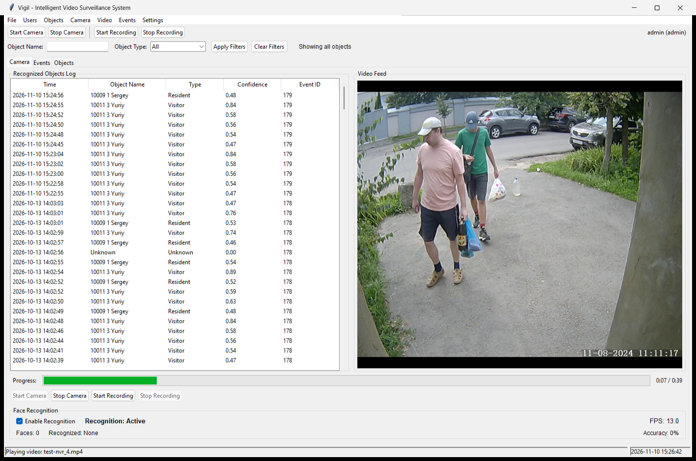
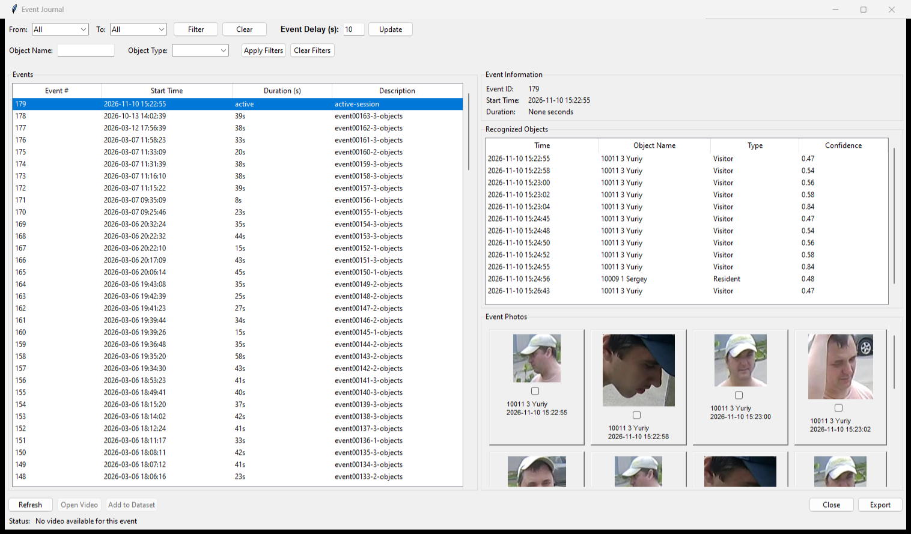
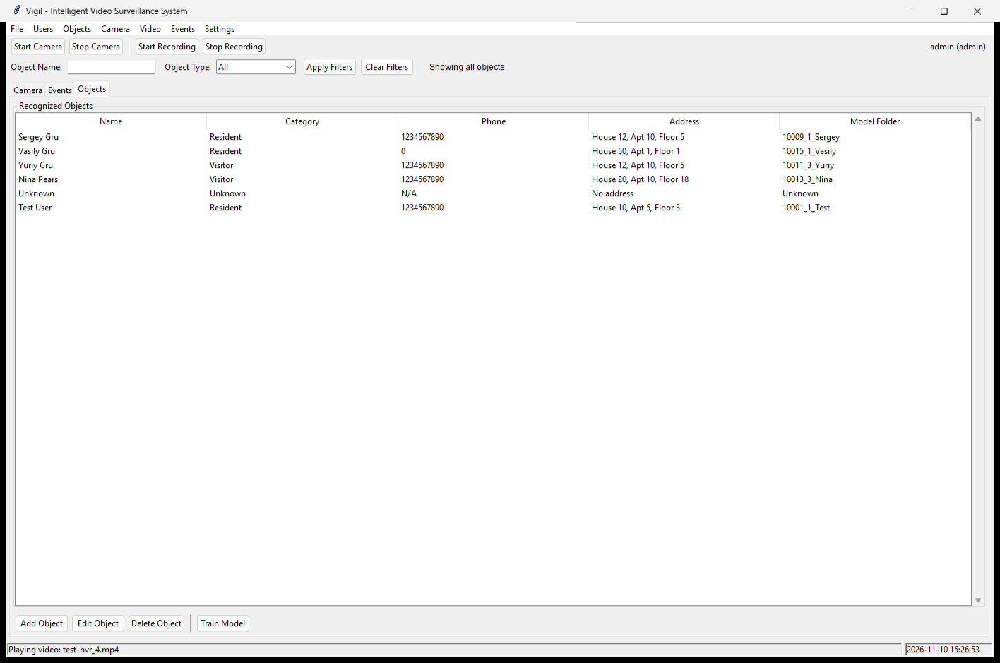

# Vigil (prev. Dozor): Video Surveillance with Face Recognition

Vigil is a local video surveillance application for real-time monitoring, face recognition, and event review. It captures from cameras and video files, identifies people against a trained dataset, and stores events, photos, and short video clips on the local machine. All data lives in SQLite databases and files under `data/`.

The application is built with Python, OpenCV, dlib, and the face_recognition library. The application serves small businesses, residential complexes, and schools that need local recording without a cloud subscription.

## Table of Contents
- [Features](#features)
- [Screenshots](#screenshots)
- [System requirements](#system-requirements)
- [Installation](#installation)
- [Usage](#usage)
- [Event journal](#event-journal)
- [Object management](#object-management)
- [Event video recording](#event-video-recording)
- [Project structure](#project-structure)
- [Configuration](#configuration)
- [License](#license)

## Features

### Monitoring and recognition
Vigil captures from IP cameras, USB webcams, and video files. Face detection uses a dlib CNN or HOG model, and recognized faces appear on the live feed with a name and confidence score. Unknown faces are flagged. Frame processing skips frames on high-resolution sources to keep the interface responsive.

### Event management
Vigil groups recognition events into sessions based on an inactivity delay. The Event Journal lists sessions, filters by date, object name, and object type, and shows the recognized people and captured photos for each session. You can export events to a text file from the Event Journal.

### Object management
Create, edit, and delete object profiles with a name, category, phone number, address, and comments. Upload a custom avatar or use the category default. Add photos to a person's dataset and retrain the recognition model when the dataset changes.

Categories are Resident, Staff, Visitor, and Unknown. Each category has a default avatar color: green, grey, blue, and red.

### Security and administration
Two roles control access. Administrators can manage users, cameras, settings, model training, and avatars. Operators can monitor, record, stream, review events, and edit object profiles. Avatar upload and removal require the `can_manage_objects` permission.

Vigil hashes passwords with SHA-256. The application tracks login attempts and locks an account after three failed attempts. The application writes activity to `log.log`.

### Video and media
A circular buffer holds the last 10 seconds of video at 10 FPS. When a recognition event starts a session, Vigil saves the buffer as an MP4 clip. The Event Journal includes a video player with play, pause, stop, seek, frame stepping, and playback speed from 0.5x to 3.0x.

### Architecture
The application uses a modular package layout with separate modules for capture, processing, recognition, events, database access, and the Tkinter GUI. Video capture and processing run on background threads so the interface stays responsive. Five SQLite databases store settings, users, objects, camera configuration, and events.

## Screenshots







## System requirements

### Minimum
- Windows 10/11 or Linux (Ubuntu 18.04+)
- Python 3.8 or higher
- 4 GB RAM (8 GB recommended)
- 10 GB free disk space for the application, databases, and media
- A webcam, IP camera, or video file

### Recommended
- Multi-core CPU
- NVIDIA GPU with CUDA for faster CNN face detection (dlib must be built with CUDA)
- 8 GB or more RAM
- SSD storage for databases and video

### Dependencies
Dependencies are listed in `requirements.txt`.

```bash
pip install -r requirements.txt
```

For CUDA-accelerated face recognition, create a conda environment and install dlib with CUDA support:

```bash
conda create -n dlib-cuda python=3.8
conda activate dlib-cuda
pip install -r requirements.txt
```

## Installation

1. Clone the repository:
   ```bash
   git clone <repository-url>
   cd dozor-clone
   ```

2. Create an environment:
   ```bash
   conda create -n dlib-cuda python=3.8
   conda activate dlib-cuda
   ```
   Or use a virtual environment:
   ```bash
   python -m venv vigil-env
   source vigil-env/bin/activate  # Linux/macOS
   vigil-env\Scripts\activate     # Windows
   ```

3. Install dependencies:
   ```bash
   pip install -r requirements.txt
   ```

4. Create the first administrator:
   ```bash
   python setup_admin.py
   ```

5. Start the application:
   ```bash
   python main_new.py
   ```

### First run
1. Launch `python main_new.py`.
2. Log in with the administrator account created by `setup_admin.py`.
3. Open Camera and Recognition Settings to choose a camera or video file.
4. Add object profiles and upload dataset photos.
5. Train the recognition model from Object Management.

## Usage

### Basic workflow
1. Log in with an administrator or operator account.
2. Configure a camera source in Camera and Recognition Settings.
3. Add the people you want to recognize.
4. Start the camera from the Camera tab or the toolbar.
5. Review recognition activity in the Event Journal.

### Key operations
- Objects, Add Object creates a profile.
- Objects, Train Model retrains the recognition model.
- Events, View Events opens the Event Journal.
- Camera, Camera Settings configures the video source.
- Users, User List manages accounts (administrators only).

### Performance tips
- Use a CUDA build of dlib for CNN face detection.
- Lower the recognition confidence threshold if faces are missed, or raise it to reduce false matches.
- Adjust the inactivity delay to control how events are grouped.
- Retrain the model after adding dataset photos.

## Event journal

The Event Journal lists recognition sessions and their details.

### Session management
Vigil groups events into sessions based on the inactivity delay. The default delay is 10 seconds; an administrator can change it. Each session gets an automatic description such as `event00017-3-objects`.

### Filtering
Filter by date range, object name (partial match), or object type (Resident, Staff, Visitor, Unknown). You can combine filters.

### Photos
Vigil captures photos of recognized people automatically and stores them under `data/captured_faces/{object_name}/{timestamp}_{object_name}.jpg`. Vigil does not save photos of unknown faces. The gallery reflows between 2 and 8 columns depending on the window width, with a 140 px minimum per photo. Vigil renders thumbnails at 120x120 px.

### Video
Sessions with a recorded clip show an Open Video button. The player supports play, pause, stop, seek, frame stepping, and speeds from 0.5x to 3.0x.

### Access
Administrators can change the inactivity delay. Operators can view events, photos, and videos.

### Database tables
- `event_sessions` holds session metadata (ID, start and end times, duration, description).
- `event_objects` holds recognized objects with confidence scores.
- `event_photos` holds photo records with file paths and timestamps.
- `event_videos` holds video metadata with file information and duration.

## Object management

### Profiles
Create, read, update, and delete object profiles. Each profile stores a first and last name, category, phone number, address, comments, avatar, and recognition encodings.

### Avatars
Upload a JPG, JPEG, PNG, BMP, or GIF image up to 5 MB. Vigil resizes images with PIL LANCZOS and saves them as JPEG at quality 85. Vigil names uploaded avatars with a UUID and stores them in `data/photo/objects/`. Default avatar colors are green for Resident, grey for Staff, blue for Visitor, and red for Unknown.

### Datasets
The application stores dataset photos in `data/dataset/{object_name}/`. Add or remove photos for a person, then retrain the model. Only administrators can train the model.

### Operator access
Operators can view profiles and edit object details. Avatar upload and removal require administrator permissions.

## Event video recording

### Buffer
A circular buffer holds the last 10 seconds of video at 10 FPS. When a recognition event starts a session, Vigil writes the buffer to `data/event_videos/event_{session_id}_{timestamp}.mp4` using the MP4V codec. The `event_videos` table stores video metadata.

### Playback
Open an event in the Event Journal and choose Open Video. The player supports play, pause, stop, seek, frame stepping, and speeds from 0.5x to 3.0x.

### Cleanup
Deleting an event removes its associated photos, objects, and video records from the database.

## Project structure

```
vigil/
├── core/                       # Application controller and exceptions
├── config/                     # Constants and settings management
├── database/                   # SQLite managers for all databases
├── auth/                       # Authentication and role-based authorization
├── gui/
│   ├── main_window.py          # Main Tkinter window
│   └── dialogs/                # Login, event journal, object, video, and training dialogs
├── video/                      # Capture, frame processing, and the event buffer
├── recognition/                # Face detection, training, and the training service
├── events/                     # Event logger and session manager
├── services/                   # Object service
├── models/                     # Object data model
└── utils/                      # Dataset manager and logging
```

Entry points:
- `main_new.py` is the modular application.
- `setup_admin.py` creates the first administrator.
- `transliterate.py` is a Russian to English transliteration helper.

### Databases
- `data/setting.db` stores application settings.
- `data/authentication.db` stores users and roles.
- `data/objects.db` stores object profiles and recognition data.
- `data/camerasetting.db` stores camera configuration.
- `data/events.db` stores events, sessions, photos, and videos.

### Media storage
- `data/captured_faces/` holds event photos organized by object.
- `data/event_videos/` holds event video clips.
- `data/photo/objects/` holds object avatars.
- `data/dataset/` holds training datasets organized by object.

## Configuration

The application stores settings in `data/setting.db`, and you edit them through the Camera and Recognition Settings dialog. Key options include the recognition confidence threshold (45% in the bundled database), the inactivity delay (10 seconds), the recognition frame skip, the recognition cooldown, camera resolution and quality, and video playback speed and loop behavior.

The application defines database paths in `vigil/config/constants.py`. It configures logging in `vigil/utils/logging_config.py`, which writes to `log.log`.

## License

MIT License. The repository does not currently include a LICENSE file.
